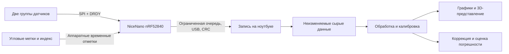

# Архитектура

Статус: проектное решение; реализация и аппаратная приёмка отсутствуют.

## Цель

Получить проверяемые исходные измерения движения люльки и положения коленвала, затем оценивать эквивалентный дисбаланс в двух выбранных плоскостях. Исследовать, улучшают ли дополнительные оси/гироскопы и переходные прогоны результат относительно простого двухканального измерения. Не обещать восстановление единственного распределения массы всех противовесов или точность из количества каналов.

## Граница контроллера

Контроллер отвечает за питание/инициализацию датчиков, SPI, регистрацию событий, временные отметки, обнаружение пропусков, ограниченные очереди и передачу. Он не вычисляет решение балансировки и не управляет дрелью. Остановка программы ноутбука не является аварийным остановом механики.

Расширение D12 по последующему запросу владельца: [регулятор прижимного электропривода и прогон по RPM](SPEED_SWEEP_CONTROL.md) планируются отдельно. NiceNano предполагается поручить локальную обратную связь/пределы, ноутбуку — анализ и выбор следующей полки. Расширение ещё не реализовано; ему нужны отдельный контракт, драйвер и приёмка, текущие команды захвата мотор не включают.

Захват привязан к общему аппаратному времени. У датчиков собственные часы: общий контроллер и быстрая SPI не делают измерения одновременными. Чтение USB на ПК также не задаёт момент измерения. Отдельно хранятся время готовности данных, конфигурация фильтров и модель задержки.

## Граница ноутбука

Первый компонент — запись и воспроизведение двоичных кадров. Запись должна работать без графиков и тяжёлого расчёта. Анализ выполняется по сохранённым данным: NumPy/SciPy, фазовая привязка, оценка гармоник, калибровка, взвешенное решение, проверки остатка и доверия.

Предпочтительный первый интерфейс — CLI. Визуализация добавляется после записи/воспроизведения. Не начинать с большого GUI. 3D-картинка — результат модели с указанной полосой/масштабом, а не обещание абсолютной траектории в микрометрах после двойного интегрирования.

## Механика

Люлька имеет согласованную систему координат X вдоль коленвала, Y поперёк, Z вверх. Положение, ориентация и идентификатор каждого датчика фиксируются. Метка измеряет угол вала относительно несущей её конструкции. В модель входят поступательные/угловые движения, привод, подвеска, трение, гравитационная составляющая и, при необходимости, гироскопическая связь.

Замена подвеса, опор, положения датчиков, муфты или частотных настроек делает прежнюю калибровку кандидатом на повторную проверку. Эквивалентный дисбаланс и систематическое воздействие привода могут быть неразличимы; избыток каналов не отменяет этого ограничения.

## Данные и происхождение

- `data/runs/` — исходные реальные записи, локально, исключены из Git.
- `evidence/local/` — фотографии платы, серийные номера, локальные трассы и отчёты; исключены из Git.
- `evidence/reports/` — проверенные обезличенные итоговые отчёты, пригодные для публикации.
- `templates/` — пустые формы; заполненный шаблон не становится доказательством автоматически.
- `firmware/` и `host/` — будущие независимые реализации; сейчас только описание назначения.

В каждой сессии: UUID, конфигурация/её хеш, версии ПО, тип источника (`synthetic`, `bench`, `rotor`), часы и временная эпоха, настройки каждого датчика, механическая конфигурация, скорость/угол, известные пробные грузы и полные счётчики потерь. Производные файлы содержат ссылки/хеши исходных записей; сырые данные не исправляются задним числом.

## Ограничения первой версии

Только NiceNano/nRF52840 и ноутбук. USB — обязательный основной путь; Bluetooth отдельный будущий этап. Диапазон 400–3000 об/мин — исследуемая область, не допуск конструкции. Начальные вращательные испытания ограничены отдельными механическими gates и малыми оборотами. Снятие металла не входит в запуск первой измерительной версии.

См. [аппаратуру](HARDWARE.md), [прошивку](FIRMWARE.md), [протокол](DATA_PROTOCOL.md), [обработку](SIGNAL_PROCESSING.md), [приёмку](VALIDATION.md).
