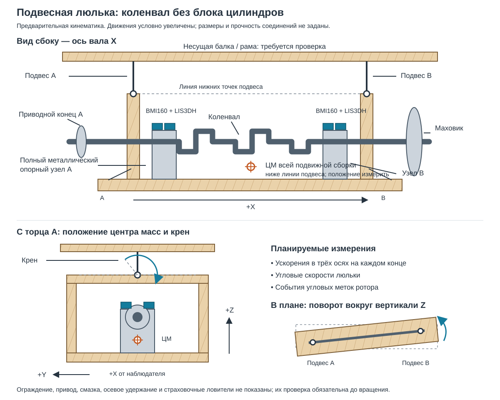

# Механика стенда

Статус: **planned**. Этот документ задаёт предварительную конструкцию и условия её проверки. Стенд не изготовлен и не принят; размеры креплений, допустимая нагрузка и разрешённая скорость ещё не определены.

Навигация: [начало проекта](../README.md), [электроника](HARDWARE.md), [обработка сигналов](SIGNAL_PROCESSING.md), [приёмка](VALIDATION.md), [этапы](ROADMAP.md), [источники](SOURCES.md).

## 1. Результат этого этапа

Нужна лёгкая жёсткая деревянная люлька, несущая коленвал с маховиком и шкивом **без блока цилиндров**. На двух разнесённых концах устанавливаются металлические опорные узлы и датчики. Подвес допускает небольшие перемещения и повороты, которые измеряются и учитываются в калибровке.

Приняты следующие направления:

- основной исследуемый вариант — два подвеса вдоль оси вала; центр масс подвижной сборки находится ниже линии их нижних точек крепления;
- четыре круглых подвеса по углам — запасной вариант, если два подвеса не дают устойчивого и повторяемого отклика;
- ускорения и угловые скорости измеряются во всех доступных осях; крен и поворот люльки не считаются автоматически помехами;
- привод, маслосистема, ограждение и опоры входят в паспорт установки;
- конструкция опор вала выбирается **до изготовления**: полноценные металлические узлы скольжения либо подходящие роликовые опоры.

Изменение этого выбора требует обновления паспорта установки и проверки калибровки. Деревянная конструкция не означает, что постели подшипников и удержание вращающихся деталей также делаются из дерева.

## 2. Наглядная кинематическая схема

Схема показывает взаимное расположение частей; металлические опоры изображены условно, их тип ещё выбирается. Она не задаёт размеры соединений, сорт древесины, допустимую нагрузку или конструкцию ограждения. Движения на рисунке условно увеличены. На готовом стенде измеряемые перемещения могут составлять единицы микрометров.

Общие оси: X направлена вдоль вала от приводного конца A к концу B, Z вверх, Y дополняет правую тройку. Поэтому при взгляде со стороны A в сторону B направление +Y видно влево. На рисунке крен показан относительно продольной линии нижних точек подвеса; она не обязана совпадать с осью вала. При связанных движениях фактическая мгновенная ось поворота может изменяться.

## 3. Что должно быть известно до чертежа

Карточка: [G06 — механическая люлька](../tasks/G06-mechanical-cradle.md).

В паспорт установки входят:

| Параметр | Для чего нужен | Текущий статус |
|---|---|---|
| Масса коленвала, маховика и шкива отдельно | Нагрузка, центробежные силы, суммарная инерция | Не измерена |
| Масса люльки, опор, датчиков и закреплённых проводов | Полная подвижная масса | Не измерена |
| Диаметры, длины и состояние доступных коренных шеек | Выбор опор и допустимых контактных поверхностей | Не определены |
| Осевое расстояние между опорами и плоскостями коррекции | Разделение силового и моментного дисбаланса | Не определено |
| Радиусы пробных грузов и доступные угловые позиции | Перевод массы в дисбаланс | Не определены |
| Положение центра масс всей подвижной сборки | Устойчивость двухподвесной схемы | Не определено |
| Моменты инерции сборки либо способ их оценки | Частоты поворотов люльки | Не определены |
| Свободная длина, материал, диаметр и зажимы подвесов | Податливость, прочность, повторяемость | Не выбраны |
| Несущая конструкция сверху и её соединения | Передача статической и динамической нагрузки | Не проверены |
| Конструкция привода и способ остановки | Дополнительные силы и момент | Не проверены |
| Смазка, осевое удержание и ограждение | Допуск к вращению | Не разработаны |

Не подставлять известную массу двигателя вместо массы этой сборки. Не объявлять покупную струну или потолочное крепление подходящими только по внешнему виду.

## 4. Деревянная люлька

### 4.1. Назначение дерева

Дерево образует лёгкую жёсткую несущую конструкцию. Желательны коробчатые элементы из качественной фанеры с замкнутым сечением, поперечными диафрагмами и соединениями, работающими без микроскольжения. Сама люлька должна сохранять расстояние и ориентацию металлических опор.

Упругость измерительного подвеса задаётся отдельными подвесами. Нельзя одновременно рассчитывать, что случайно подобранные деревянные ножки будут и жёсткой базой, и воспроизводимой измерительной пружиной.

Предварительные требования:

1. Опоры соединены жёсткими продольными элементами и поперечными связями.
2. Нагрузки от опор и подвесов распределяются через металлические накладки и сквозные соединения, рассчитанные для выбранного материала.
3. Подшипниковые узлы можно выставить по геометрии и зафиксировать без подкладок, способных ползти или сжиматься.
4. Снаружи нет деталей, способных задеть маховик, шкив, муфту или пробные грузы при допустимом движении.
5. Масло не впитывается в дерево; покрытие и поддон не создают незапланированных связей с неподвижной рамой.
6. Крепления доступны для осмотра и контрольной отметки положения.
7. Дополнительный балласт не кладут на подвижную люльку ради «устойчивости» без пересчёта чувствительности и подвеса.

Влажность влияет на размеры деревянных деталей; покрытие замедляет изменение влажности, но не устраняет его. Для повторяемости записываются условия хранения и состояние соединений. Обоснование: [USDA, изменение размеров древесины и контроль влажности](https://research.fs.usda.gov/treesearch/7143).

### 4.2. Когда люлька считается достаточно жёсткой

Это определяется испытанием, а не только толщиной фанеры. При осторожном возбуждении неподвижной сборки сравнивают ускорения и угловые скорости на двух концах. В выбранной рабочей полосе модель одного жёсткого тела должна предсказывать согласованные отклики с приемлемым остатком.

Если выявляется заметное изгибание или кручение люльки, действуют по порядку:

1. проверяют крепление датчиков и временные задержки;
2. проверяют люфты и микроскольжение соединений;
3. меняют конструкцию люльки либо сужают измерительную полосу;
4. повторяют проверку и создают новую версию механического паспорта.

Увеличение числа каналов не превращает нежёсткую люльку автоматически в известную механическую модель.

## 5. Опоры коленвала

### 5.1. Узлы скольжения

Штатный бугель и половина вкладыша не являются готовым автономным подшипниковым узлом. Вкладышу нужны металлическая постель правильной геометрии, предусмотренное обжатие, удержание и смазка. Штатные бугели обработаны совместно со своим блоком; их перенос в новую конструкцию требует проверки геометрии новой полной постели.

До вращения необходимо определить:

- полную конструкцию разъёмного металлического корпуса;
- соответствие диаметру, овальности, конусности и состоянию шейки;
- рабочий зазор и способ его проверки;
- соосность двух опор в закреплённой люльке;
- осевое удержание без нежелательного зажатия вала;
- стабильную подачу чистого масла, сбор слива и контроль температуры;
- допустимость использования выбранных шеек и сохранность их поверхностей.

Давление и расход смазки не задаются универсальными числами: они зависят от корпуса, зазоров, масла и условий. Несущая плёнка в подшипнике скольжения формируется движением поверхности; подача масла восполняет его и отводит тепло. [MAHLE: масляная плёнка и повреждения подшипников](https://www.mahle-aftermarket.com/na/en/support/installation-tips/bearings-failure-prevention.jsp).

Применение подшипников скольжения на балансировочном станке принципиально возможно: [Schenck, многоподшипниковая измерительная рама](https://www.schenck-rotec.com/en-de/product/crankshafts). Это не подтверждает пригодность самодельной неполной постели.

### 5.2. Роликовые опоры

Альтернативный вариант — роликовые опоры на доступных гладких участках коренных шеек. До выбора требуется проверить:

- доступность шейки между противовесами;
- состояние, соосность и биение роликов;
- совместимость контактных материалов и сохранность шеек;
- устойчивость вала на опорах и удержание от схода;
- осевую фиксацию;
- зазоры до противовесов и вращающихся креплений;
- собственные периодические помехи роликов и воспроизводимость установки.

Обычный цельный подшипник качения нельзя считать устанавливаемым на любую коренную шейку: геометрия коленвала может не позволять надеть его без разборного специального решения.

Окончательное решение записывается в карточке G06. До этого чертёж опор остаётся предварительным.

## 6. Два или четыре подвеса

### 6.1. Основной вариант: два подвеса вдоль вала

Две нижние точки расположены в разнесённых сечениях люльки. Их линия примерно параллельна оси вала. Центр масс **всей подвижной сборки** должен находиться ниже этой линии с проверенным запасом для всех предусмотренных комплектаций.

Такой подвес может допускать:

- поперечное и продольное перемещение;
- поворот в плане вокруг вертикали;
- крен вокруг продольной линии подвеса;
- связанные движения, определяемые геометрией и приводом.

Крен не запрещается только потому, что он присутствует. Его измеряют гироскопами и включают в модель. При этом необходимо проверить устойчивость, достаточные зазоры, отсутствие ударов и повторяемость отклика.

Если центр масс выше линии нижних креплений, свободный крен может быть неустойчивым. Если он ниже, сохраняется конечная податливость к моменту привода; угловые движения и проекция тяжести на оси акселерометров остаются частью измерительной задачи.

### 6.2. Запасной вариант: четыре круглых подвеса

Четыре нижние точки образуют прямоугольник. Круглые подвесы податливы в обоих горизонтальных направлениях и позволяют небольшой поворот в плане. Длина и нагрузка по подвесам регулируются; отсутствие слабины проверяется для всей комплектации.

Четыре широкие параллельные плоские ленты **не являются эквивалентной заменой**. При повороте люльки угловым точкам нужны смещения и вдоль вала, где широкая лента может быть очень жёсткой. Поэтому такой вариант требует отдельной кинематической проверки.

Переход к четырём подвесам применяется, если основная схема не проходит проверку устойчивости, геометрии или повторяемости. После перехода прежняя матрица влияния не считается действительной без проверки.

### 6.3. Три подвеса

Три неколлинеарные нижние точки также могут образовать устойчивую схему. Проекция центра масс должна находиться внутри треугольника, все подвесы должны оставаться натянутыми. Третий подвес на одной линии с первыми двумя не устраняет свободный крен. Этот вариант не принят как основной и требует отдельного решения.

### 6.4. Расчётная граница

Формула простого маятника даёт первоначальный ориентир частоты:

~~~text
f0 ≈ sqrt(g / L) / (2π)
~~~

Например, L = 0,25 м даёт около 1 Гц. Это **расчётный пример**, а не измеренная частота стенда. Реальная частота зависит от изгибной жёсткости подвеса, зажимов, нагрузки и геометрии. Для поворота нужны ещё момент инерции и расстояния между подвесами.

Статическое напряжение от веса не доказывает безопасность. Отдельно рассматриваются зажимы, изгиб возле кромок, усталость, повреждения материала, возможные удары, нагрузки на верхнюю балку и деревянные соединения. Тип, диаметр и длина подвесов пока не утверждены.

Принцип мягкой маятниковой подвески используется в промышленных балансировочных машинах: [IRD, конструкция мягких опор](https://irdproducts.com/ird-balancing-products). Их паспортные точности не переносятся на данный проект.

## 7. Привод и его реакции

Дрель закрепляется в известном положении. Проверяются соосность, биение адаптера, крепление шкива, муфта и воспроизводимость переустановки. Шпилька и шланг не считаются проверенной муфтой только потому, что способны передать вращение.

Если дрель закреплена отдельно от люльки, не весь момент разгона ротора передаётся люльке:

~~~text
J_rotor * alpha = T_drive - T_bearing - T_other
~~~

Люлька получает моменты от трения опор, приложенных сил, несоосности и других связей. Реактивный момент статора отдельно закреплённой дрели воспринимает её собственная опора. При размещении двигателя на люльке баланс моментов меняется; это другая конфигурация.

Гибкая муфта, даже очень мягкая, может добавлять синхронные силы, смещать собственные частоты и менять фазу. Проверка включает повтор после переустановки привода. Холостой фон дрели не вычитается автоматически из рабочего сигнала.

Выключенная, но присоединённая дрель остаётся частью механической системы и может тормозить вал. Выбег с физически отключённым приводом возможен только с заранее спроектированным механизмом разобщения и ограждением. Вручную разнимать вращающиеся соединения нельзя.

## 8. Датчики, провода и маслосистема

На каждом конце располагаются BMI160 и LIS3DH с известными координатами и ориентацией. Их крепят к жёстким металлическим площадкам опорных узлов. Нельзя использовать изменение материала площадки как неизвестный «усилитель» сигнала.

Крепление должно быть воспроизводимым, без дребезга и мягких промежуточных слоёв. Платы и провода не должны изгибаться при движении люльки. Общий принцип влияния крепления изложен у [PCB Piezotronics](https://www.pcb.com/resources/technical-information/mounting); конкретное крепление платы MEMS проектируется отдельно.

Провода, подача и слив масла:

- имеют свободные петли и разгрузку возле подвижной части;
- не касаются вращающихся деталей;
- не натягиваются в пределах допускаемых движений;
- не трутся о неподвижную раму;
- фиксируются одинаково между исходным и пробными прогонами.

Фазовый датчик крепится так, чтобы его положение относительно опор и метки было воспроизводимым. При заметном движении всей люльки предпочтительна общая с ней опора датчика; геометрия записывается.

## 9. Что означает цель «1 грамм»

Масса без радиуса не задаёт дисбаланс:

~~~text
U = m * r
1 г на радиусе 100 мм = 100 г·мм = 0,0001 кг·м
~~~

Для простого поступательного движения далеко выше собственной частоты:

~~~text
x_peak ≈ U / M_total
a_peak ≈ U * omega² / M_total
~~~

**Расчётный пример, не измерение:** полная подвижная масса 30 кг, 1000 об/мин, U = 100 г·мм. Получаются около 3,33 мкм перемещения и 3,73 mg ускорения. Здесь mg означает тысячную ускорения свободного падения.

Пример не учитывает моментный отклик, податливость привода, несимметрию опор, шум, фильтры и калибровочную неопределённость. Он показывает возможный масштаб сигнала и не подтверждает достигнутую точность.

## 10. Допуск к первому вращению

Карточки: [G08 — неподвижный стенд](../tasks/G08-stationary-bench.md), затем [G09 — малые обороты](../tasks/G09-low-speed-rotor.md).

До привода должны быть проверены и записаны:

1. Несущая конструкция сверху, подвесы, зажимы, люлька и крепление опор.
2. Устойчивость сборки и положение центра масс.
3. Осевое удержание, свободное вращение, зазоры и смазка.
4. Ограждение вращающихся деталей и механическое удержание пробных грузов.
5. Монтажные опоры и страховочные ловители; при измерении они не касаются люльки.
6. Доступная остановка привода и отсутствие самопроизвольного запуска.
7. Целостность измерения: метка, переполнения, временная шкала и запись.
8. Проверка неподвижной сборки по перемещениям и поворотам.

Первая исследуемая рабочая область — **600–1000 об/мин**, после разрешения конкретной механической конфигурации. Первоначальная граница интереса 400–3000 об/мин не является разрешением разгона до 3000. Расширение скорости требует отдельного завершённого этапа и доказательств.

Снятие металла с коленвала и постоянная установка корректирующих грузов не входят в первоначальную проверку. Проверка временными механически удерживаемыми грузами описана как будущий этап на принятом стенде. В текущей поставке выполняется только планирование; данный документ сам по себе не разрешает изготовление, запуск или обработку деталей.
