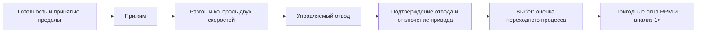

# Отводимый привод и контроль сцепления

Статус: **planned / требование владельца 2026-10-30**. Уточнение D12/D13, [G06](../tasks/G06-mechanical-cradle.md), [G09](../tasks/G09-low-speed-rotor.md) и [G11](../tasks/G11-transient-3d.md). Владелец сообщил, что заказал JGB37-520; получение, характеристики экземпляра и электрические уровни ещё не проверены. Энкодер двигателя, механизм отвода, телеметрия и автомат управления пока не реализованы. Аппаратные зависимости не сняты.

Связи: [управление оборотами](SPEED_SWEEP_CONTROL.md), [свободный выбег](COASTDOWN_PROTOCOL.md), [калибровка](CALIBRATION_PROTOCOL.md), [тайминг и фаза](../tasks/G04-timing-phase.md), [источники](SOURCES.md).

## 1. Требуемый результат

Двигатель с колесом разгоняет коленвал. Во время контакта контроллер наблюдает оба вращения и обнаруживает потерю сцепления. Затем колесо физически отводится; основной анализ выполняется по сигналам коленвала на свободном выбеге. Разгон с контактом остаётся диагностической записью, а не автоматически пригодным балансировочным окном.

Разобщение устраняет непосредственную передачу сил через колесо. Остаются трение и биение опор, влияние рамы/пола, кабелей и переходный процесс отвода. Требование «чистый выбег» не означает отсутствие всех посторонних сигналов.

## 2. Два независимых измерения вращения

- A/B энкодера JGB37-520: время фронтов, счётчик, направление, скорость двигателя и пересчитанная скорость выходного вала редуктора. Параметры PPR, способ счёта фронтов и реальное передаточное число подтвердить по известному числу оборотов; редуктор учитывать один раз.
- Метка/зубчатый канал непосредственно коленвала: время фронтов, угол и фактические RPM. Это основной источник фазы анализа и скорости ротора; энкодер мотора его не заменяет.

Для согласованных временных окон при контакте:

```text
n_expected = n_wheel * D_wheel_effective / D_contact
slip = 1 - n_crank / n_expected
```

Диаметры и скорости должны использовать одинаковые единицы и согласованные направления. Нулевой/малый знаменатель, пропуски фронтов и несогласованные окна дают `quality_invalid`, а не процент проскальзывания. На разгоне нельзя сравнивать свежую оценку одного канала с запаздывающим средним другого.

Эффективный диаметр мягкой шины меняется от прижима; люфт, ошибки передаточного отношения и квантование тоже дают расхождение. Сначала измерить базовое отношение и его разброс при заданном прижиме. Порог и время подтверждения потери сцепления назначить до опыта по этим ошибкам; универсальный порог в процентах не принят. При известном расхождении диаметров показатель подписывать «расхождение скоростей», не выдавать его за точное физическое скольжение.

После подтверждённого отвода `slip` имеет состояние `not_applicable`: скорости колеса и коленвала должны расходиться. Потерю вращения мотора при отведённом колесе не считать потерей фазы коленвала.

## 3. Механизм

Кандидат — мотор на поворотном рычаге, закреплённом на внешнем жёстком каркасе. Ось рычага имеет собственную опору. Привод прижима двигает рычаг через упругий элемент; упругий элемент задаёт усилие, а механические упоры задают крайние положения. Сам серворедуктор не должен служить измерителем прижима.

Предпочтительный кандидат для плавного движения — **позиционный сервопривод**, не сервопривод непрерывного вращения. Обычный трёхпроводный RC-сервопривод получает команду положения импульсами и обычно не передаёт контроллеру фактическое положение. Нужен отдельный датчик положения рычага `RETRACT_CONFIRMED`; команда «отведено» не доказывает отвод. [Принцип управления RC-сервоприводами](https://www.pololu.com/blog/16/electrical-characteristics-of-servos-and-introduction-to-the-servo-control-interface).

Соленоид — электромагнитный линейный толкатель/втягиватель; он тоже возможен, но нужно проверить силу на всём ходе, допустимую длительность включения, нагрев, удар и возврат. Конкретный сервопривод/соленоид пока не выбран. Микросерво нельзя выбирать только по небольшому ходу.

Модельный пример оценки: сила 10 Н на плече 20 мм даёт 0,20 Н·м, примерно 2,04 кгс·см, до потерь, возвратной пружины и запаса. Реальный момент зависит от кинематики на всём ходе и массы моторного узла. Это не назначенное усилие прижима и не готовый номинал серво.

Отведённое положение должно давать зазор при всём принятом движении люльки и биении ротора, а не только в покое. Датчик подтверждает положение рычага; достаточность зазора отдельно доказывается геометрией и испытаниями. Возвратная пружина сама по себе не гарантирует отвод: редуктор сервопривода/защёлка могут удерживать рычаг без питания. Поведение при обрыве питания и заклинивании проверить отдельно.

## 4. Последовательность и записи



Непрерывно сохранять raw и временные метки. Дополнительно: задание/измеренные RPM коленвала, RPM мотора/колеса, PWM, ток/ошибку драйвера, команду прижима, подтверждение положения, состояние контакта и причину каждого перехода. Не смешивать команду и измеренный факт; промежуточное состояние контакта — `unknown`.

Порядок снижения тяги, движения рычага и отключения двигателя принять при проверке узла: резкое торможение через прижатое колесо создаёт возмущение. Для DRV8874 в PH/EN нулевой EN соответствует электрическому торможению, а не свободному вращению; состояние nSLEEP/выходов проверить по выбранной плате. [Режимы драйвера](https://www.pololu.com/product/4035).

Автоматический вход в балансировочное окно разрешён только после подтверждения отвода и выполнения критериев пригодности. Отвод не подтверждён к принятому сроку, потеря фазы, превышение ограничений или отказ привода приводят к явному отказу прогона и заранее проверенному действию ограничения/отключения. Не продолжать разгон и не выдавать коррекцию. Нет автоматического повторного прижима к ещё вращающемуся ротору после сброса/связи; следующий разгон требует подтверждённой остановки и нового разрешения.

Окно после отвода нельзя объявлять пригодным по одной фиксированной паузе. Проверить затухание переходного процесса, насыщение датчиков, пригодность угла и повторяемость 1×. На выбеге частота меняется: нужны угловая привязка/локальные окна, фактические RPM и угловое ускорение. Одна FFT всего выбега размажет 1×. Матрицы влияния получать с тем же состоянием отвода, настройками и согласованными RPM/темпом выбега. Чистый выбег не гарантирует применимость стационарного расчёта при быстром замедлении; проверка G11 сохраняется.

## 5. Выводы и питание

Четыре датчика: SPI 3 + CS 4 + DRDY 4 = 11 GPIO; два оптических входа коленвала = 2; энкодер мотора = 2; PWM/разрешение мотора = 2; ошибка/АЦП тока = 2. Итого 19. Прямое управление серво и датчик отвода добавляют 2: **21 без OLED**. OLED по I²C добавляет ещё 2: **23**, больше заявленных для оригинального NiceNano 21. У клона даже доступность 21 ещё не подтверждена. [NiceNano](https://nicekeyboards.com/docs/nice-nano/).

Это бюджет сигналов, не принятая распиновка/раскладка периферии. Первая USB-версия без OLED теоретически помещается без запаса. Для OLED и дополнительных концевиков нужен пересмотр: например, I²C-контроллер серво и расширитель медленных входов. Энкодеры, метки и DRDY остаются напрямую на MCU. PCA9685 — только кандидат генератора команд серво; он не заменяет драйвер JGB37-520 и подтверждение положения. Его сохранённый PWM при потере связи не является безопасным состоянием; отдельно требуется проверенное аппаратное запрещение/действие при отказе.

Серво питается от отдельной подходящей силовой линии по его паспорту, не от VCC NiceNano; логические уровни, общая земля и токовые пути проверяются. Частота команд серво и частота силового PWM двигателя различны. Ни драйвер, ни GPIO фактического клона ещё не приняты.

## 6. Проверки перед реализацией

1. Сначала симулятор без COM/GPIO: сцепление и скольжение, разные задержки скоростей, нулевые RPM, пропущенные импульсы, задержка/отказ отвода, переходный толчок, сброс/потеря связи. Проверить отсутствие ложного скольжения после отвода и отсутствие результата при неподтверждённом зазоре.
2. Узел без коленвала: измерить усилие/ход/момент, положения, уровни питания/сигналов, потребление, нагрев, отказ и стартовые состояния. Заранее назначить сроки/пределы по выбранным деталям.
3. После аппаратных зависимостей — статическая сборка: подтвердить зазоры при предельных разрешённых отклонениях, сохранность шеек, отсутствие связи от рычага/проводов и удержание отвода.
4. Роторный опыт только в принятом диапазоне: одинаковые выбеги без изменения груза, затем калибровка A/B и независимые контрольные грузы. Сравнить оценки на согласованных RPM/ускорениях и повторных отводах. Сохранить исключённые окна и причины отказа.

Следующий программный срез: реализовать независимый симулятор состояний и телеметрии, без запуска реального привода. Документ не является прошивкой или приёмкой G06–G11.
