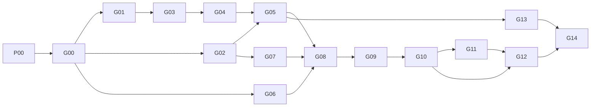

# План реализации и контрольные точки

Первая поставка содержала только законченный план. Следующим запросом владелец поручил начать реализацию. Текущая карточка: [P00 — подготовка проекта и публикация плана](../tasks/P00-project-setup.md), затем [G00 — паспорт оборудования](../tasks/G00-board-passport.md). Статусы выполнения приведены в таблице ниже; аппаратная приёмка пока отсутствует. USB — основной транспорт; Bluetooth отложен до отдельного решения после приёмки USB.

Цель: воспроизводимо измерять синхронные с вращением ускорения и угловые скорости подвешенной люльки, оценивать эквивалентный дисбаланс в двух плоскостях и проверять результат известными грузами. Цель «1 г на радиусе 100 мм» означает **100 г·мм** и является проверяемой гипотезой чувствительности, а не обещанной точностью стенда.

## Как работать небольшой моделью

1. Читать [README](../README.md), [STATE](../STATE.md) и одну текущую карточку. Затем только указанные в ней источники: обычно всего 5–6 файлов. Внешний первичный источник открывать точечно, если от него зависит изменяемая настройка; не загружать всю документацию.
2. Назвать результат текущего среза, изменяемые файлы и критерий окончания. Карточка может занимать несколько раундов: реализовывать **один её срез**, сохраняя промежуточный результат.
3. Сначала получить проверяемый результат без оборудования. Прошивка платы, подключение COM, физическое нагружение и вращение выполняются только в задаче, которая явно включает соответствующее действие и называет устройство/стенд. Первоначальная задача на документацию их не разрешает.
4. Записать фактические команды, условия, результаты и ограничения в `evidence/reports/Gxx.md`. «Не проверено» является корректным результатом; его нельзя заменить предположением.
5. Обновить `STATE.md` и добавить запись в `RECENT.md`. После реализации средств проверки в P00 запускать `python tools/check_project.py` и `git diff --check`. Пока этих средств нет, проверять документы непосредственно. Следующий раунд получает конкретный оставшийся срез, а не всю историю.

Для нового этапа `planned` меняется на `in_progress` только с началом его реализации, а на `passed` — после выполнения всей приёмки. Если не хватает физического действия, запись остаётся незавершённой с точной причиной. Статус документов не является статусом оборудования.

## Уровни доказательств

| Уровень | Что подтверждает | Чего не подтверждает |
|---|---|---|
| `documentation` | Проверены ссылки, согласованность и полнота плана | Электрическую или механическую работоспособность |
| `build` | Код собирается, зависимости и карта памяти проверены | Исполнение на плате, USB и свежесть измерений |
| `synthetic` | Алгоритм получает известные входы и ожидаемые выходы | Шум, задержки и точность реальных датчиков |
| `device` | Конкретная плата/датчик работает при записанных настройках | Работу вращающегося стенда |
| `static_rig` | Собранная люлька прошла статические проверки | Динамическую безопасность и балансировку |
| `rotor` | Конкретная сборка прошла опыт в указанном диапазоне | Любые другие обороты, подвеску, ротор или калибровку |

Численные допуски в карточках — **предлагаемые критерии приёмки проекта**. Если реальное оборудование их не достигает, сначала записывают провал и причину, затем отдельно меняют требование с обоснованием. Подгонять критерий после просмотра результата без записи решения нельзя.

## Этапы

| Этап | Результат и основной контроль | Зависит от | Статус |
|---|---|---|---|
| [P00](../tasks/P00-project-setup.md) | Рабочий репозиторий, checker документов, первоначальная публикация плана | — | in_progress |
| [G00](../tasks/G00-board-passport.md) | Паспорт NiceNano, модулей, ротора; проверяемая карта выводов и неизвестные | P00 | planned |
| [G01](../tasks/G01-toolchain.md) | Воспроизводимая сборка и USB hello с сохранением загрузчика | G00 | planned |
| [G02](../tasks/G02-protocol-host.md) | Парсер/запись/повтор; CRC, разрывы и повреждения на синтетике | G00 | planned |
| [G03](../tasks/G03-single-sensor.md) | Один BMI160 по SPI 4 МГц, новые отсчёты по DRDY | G01 | planned |
| [G04](../tasks/G04-timing-phase.md) | Общие временные метки, фаза/индекс и явная неопределённость | G03 | planned |
| [G05](../tasks/G05-multisensor-usb.md) | Четыре датчика; ограниченные очереди; поток 250 кБ/с | G02, G04 | planned |
| [G06](../tasks/G06-mechanical-cradle.md) | Люлька, подшипниковые узлы, подвесы, защита; статическая приёмка | G00 | planned |
| [G07](../tasks/G07-analysis-synthetic.md) | 1× и двухплоскостной расчёт на данных с известным ответом | G02 | planned |
| [G08](../tasks/G08-stationary-bench.md) | Шум, задержки, оси и собственные формы неподвижного стенда | G05, G06, G07 | planned |
| [G09](../tasks/G09-low-speed-rotor.md) | Допущенный малоскоростной диапазон и повторяемый фон | G08 | planned |
| [G10](../tasks/G10-two-plane-calibration.md) | Два независимых пробных воздействия и контрольный груз | G09 | planned |
| [G11](../tasks/G11-transient-3d.md) | Согласование разгона/выбега с калибровкой постоянных оборотов | G10 | planned |
| [G12](../tasks/G12-uncertainty.md) | Честный предел обнаружения и остаточный дисбаланс с интервалом; статус цели 100 г·мм | G10, G11 | planned |
| [G13](../tasks/G13-endurance-recovery.md) | 90 минут без вращения; переполнение времени; разрыв USB и восстановление | G05 | planned |
| [G14](../tasks/G14-release.md) | Воспроизводимая поставка, одинаковый SHA двух площадок и пакет для аудита | G12, G13 | planned |



G02 и G06 можно выполнять параллельно электронике; G07 не требует платы. G13 можно завершить на неподвижном оборудовании до вращательных опытов. Начальная публикация **этого плана** младшей моделью в P00 не означает прохождения G14: G14 относится к будущей реализованной системе. После G14 владелец вызывает старшую модель для [независимого аудита](AUDIT_HANDOFF.md).

## Границы контрольных точек

- До G00 не назначать распиновку NiceNano как подтверждённую, не предполагать ревизию и происхождение платы.
- До G05 не считать общий USB-поток доказательством синхронности: у датчиков разные часы и задержки фильтров.
- До G08 не включать привод. Подвес, соосность, смазка, осевые упоры, кожух и удержание грузов должны иметь отдельную запись проверки.
- G09 начинается с механически разрешённой скорости, ориентир 400 об/мин; повышение до 600–1000 об/мин — последовательное, с проверкой после каждой ступени. Диапазон 3000 об/мин пока остаётся требованием на исследование, а не разрешением на запуск.
- До G10 нельзя выдавать угловое положение вибрационного пика за место снятия металла. Направление коррекции определяется экспериментальными коэффициентами влияния.
- До G12 нельзя указывать «точность до 1 г». Масса всегда сопровождается радиусом, плоскостью, скоростью и неопределённостью.
- G11 не заменяет G10: переходные процессы проверяются относительно стационарной калибровки. Колебания в нескольких плоскостях полезны только при измеряемой и повторяемой механике.

## Обязательная запись опыта

Каждый `evidence/reports/Gxx.md` содержит: цель и версию карточки; уровень доказательств; commit кода; идентификаторы конфигурации/механики/калибровки; фактические входы и настройки; команды; ожидаемый и полученный результат; pass/fail по каждому критерию; ограничения; следующий шаг. Для физических опытов добавляются дата, оператор, фото схемы монтажа, фактические напряжения/обороты/массы/радиусы и контроль креплений.

Сырые данные сохраняются в исключённом из Git `data/runs/`; отчёт хранит относительный путь, размер и SHA-256. Локальный файл и его хеш не делают измерение публично воспроизводимым: перед релизом публикуется явно разрешённая обезличенная выборка либо отмечается, какие результаты проверить извне нельзя. Синтетические примеры всегда имеют явную метку `synthetic`.

## Готовый запрос следующей модели

```text
Работай в C:\work\balancing. Прочитай AGENTS.md, README.md, STATE.md и tasks/P00-project-setup.md. Выполни только первый незавершённый срез P00. Реализацию стенда пока не начинай; не прошивай плату, не открывай COM и не включай привод. Публичные GitHub/Gitea уже согласованы, выполнять публикацию по карточке после проверки содержимого. Запиши фактический результат, обнови STATE.md и RECENT.md. Заверши точным следующим действием; не переходи к G00 автоматически.
```

## Отложенное

Bluetooth, автономное питание, датчики IEPE, расширение диапазона до 3000 об/мин и автоматическое управление приводом требуют отдельных карточек после базовой приёмки. Их нет в текущем объёме реализации. Приоритет — сохранность сырых данных, проверяемая калибровка и повторяемость.
