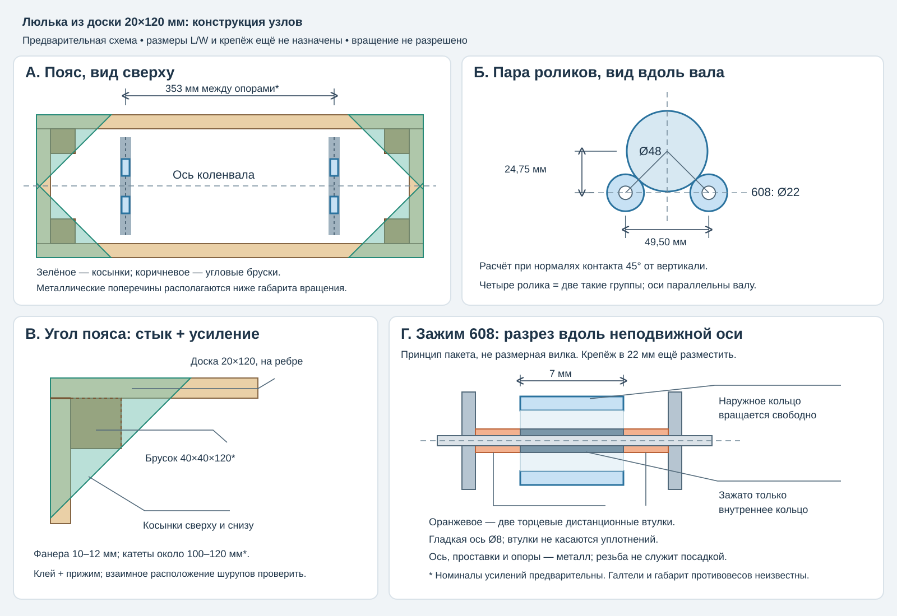

# Люлька из доски 20×120 мм и крепление роликов 608

Статус: **предварительная конструкция / documentation, 2026-10-30**. Владелец предложил открытый прямоугольный пояс из доски 20×120 мм и сообщил размеры шеек. Размеры L/W, высота оси, крепления и допустимая скорость ещё не утверждены; G06 остаётся blocked. Это схема для выбора инструмента и подготовки чертежа, не раскрой или разрешение вращения.



Связи: [паспорт ротора](../hardware/rotor-passport.md), [роликовые опоры](ROLLER_SUPPORT_CONCEPT.md), [механика](MECHANICS.md), [G06](../tasks/G06-mechanical-cradle.md), [источники](SOURCES.md).

## 1. Полученные размеры

Со слов владельца: 353 мм от начала первой до начала крайней опорной шейки, ширина шейки 22 мм, диаметр 48 мм. Способ/погрешность обмера неизвестны; подтвердить, что речь об одноимённых осевых кромках двух выбранных коренных шеек и что обе имеют ширину 22 мм.

Тогда расстояние центров шеек **353 мм**, внешний осевой габарит двух шеек **375 мм**. При выборе середины обеих шеек центры роликовых групп разнесены на 353 мм. Число 375 не является межосевым расстоянием и не задаёт длину деревянного пояса.

Владелец указал комплект четырёх ILQ-11 PRO 608RS по карточке товара. Для типоразмера 608 номинально 8×22×7 мм; фактические размеры, материал/геометрия наружной дорожки, биение, уплотнения, источник/качество и сохранность шеек пока не проверены. Отзывы о накате/сезоне эксплуатации не являются измерением пригодности стенда. Данные SKF ниже относятся к конкретному SKF 608, не паспорт ILQ.

## 2. Рекомендуемое соединение древесины

Начальный вариант: **прямой стык + угловые бруски + фанерные косынки сверху и снизу**. Паз/шип возможен при качественном изготовлении, но для этого прототипа не требует покупки фрезера. Жёсткость обеспечивают плотно склеенные поверхности, треугольные связи и повторяемые металлические опоры.

- Доски стоят на ребре: высота пояса 120 мм, толщина 20 мм. Использовать сухую прямую строганую древесину, без рыхлых сучков/трещин возле соединений и опор. Номинальные 20 мм проверить штангенциркулем.
- Две длинные доски идут непрерывно. Две торцевые вставляются между ними. Для наружных L/W и фактической толщины t: длинные детали L, торцевые W−2t. Конкретные L/W ещё не назначены.
- В четырёх внутренних углах — предварительно бруски **40×40×120 мм**, заподлицо с верхом/низом пояса. При нехватке места размеры пересчитать; не ставить брусок в траекторию вращения.
- Смежные доски приклеиваются к двум граням бруска подходящим столярным клеем по инструкции. Торцевой стык не является единственной клеевой связью. Вклеиваемые грани должны прилегать, толстый слой обычного ПВА не заменяет подгонку.
- Монтажный кандидат крепежа — шурупы по дереву около **4×50 мм** через доску в брусок, с предварительными отверстиями по инструкции выбранного крепежа. Уровни шурупов двух перпендикулярных сторон разнести, чтобы они не столкнулись. Это не рассчитанная несущая схема/не назначение момента затяжки.
- Восемь косынок из качественной фанеры **10–12 мм**, катеты ориентировочно **100–120 мм**: четыре сверху, четыре снизу. Они связывают две соседние стороны в горизонтальной плоскости и препятствуют превращению прямоугольника в ромб. Плотное приклеивание и прижим обязательны; небольшие монтажные шурупы не заменяют клеевое соединение.
- Косынки не перекрывают ролики, маховик, шкив, противовесы или доступ к крепежу. Если места мало, пересмотреть раскладку, а не вырезать усиление после сборки без проверки. Полного дна нет; при необходимости сравнить косынки с фанерной рамкой с большим центральным окном.

Такой пояс всё ещё имеет конечную податливость и может скручиваться. Косынки улучшают схему, но не доказывают отсутствие собственных форм в рабочей полосе. Для измерений нужны проверенные жёсткость, отсутствие подвижных стыков и повторяемость, а не только ручное ощущение «крепко».

## 3. Где расположить металлические опоры

Две опорные группы в плоскостях выбранных шеек, не автоматически на торцевых досках. Каждая группа содержит **два отдельных ролика**, их оси параллельны оси коленвала. Всего четыре 608. Площадки/поперечины и стойки роликов металлические; конкретное сечение ещё рассчитывается. Дерево не служит точной посадкой оси.

Опорную группу крепить сквозным крепежом с металлическими распределительными пластинами, не только саморезами в древесину. При необходимости металлические втулки ограничивают смятие дерева от затяжки; их длина определяется реальным пакетом и узлом, не просто надписью «20 мм» на доске. Эти втулки отличаются от проставок внутреннего кольца подшипника.

Датчики устанавливать на металлических опорных площадках, максимально близко к шейкам. Предусмотреть регулировку начальной геометрии и её окончательную фиксацию без люфта. Положение креплений подвеса и центр масс проверяются отдельно.

Проушины подвеса также связывать с поясом сквозным крепежом и распределительными пластинами по отдельному расчёту. Ввинченный в торец доски крючок не принят как готовое крепление подвеса. Страховочные ограничители относятся к внешнему каркасу и в измерительном положении не касаются люльки.

## 4. Геометрия пары роликов

Предварительно принять для расчётного сравнения нормали контакта 45° от вертикали, центры роликов на одной высоте. При D=48 мм и d=22 мм:

```text
S = (D+d)*sin(45°) = 49,50 мм  — расстояние осей роликов
H = (D+d)/2*cos(45°) = 24,75 мм — ось коленвала выше линии осей роликов
n_roller / n_crank = D/d = 2,182
```

Это геометрия идеальных окружностей без деформаций, не координаты отверстий в готовом кронштейне. Фактические диаметры/биение проверить. Для массы только коленвала 13,05 кг при симметричном центре масс и отведённом приводе нормальная сила около 45,3 Н на ролик. Маховик/шкив и прижим требуют другого расчёта нагрузки. Расчётная способность внутреннего подшипника не подтверждает наружный контакт с шейкой.

## 5. Как зажать подшипник

Наружное кольцо вращается по шейке, **внутреннее неподвижно на оси**. Пакет осевого зажима:

```text
металлическая опора → дистанционная втулка → ВНУТРЕННЕЕ кольцо
                   → дистанционная втулка → ответная опора/зажим
                через весь узел проходит гладкая ось Ø8
```

Наружное кольцо и защитные элементы имеют зазор до неподвижных деталей. Втулки упираются только в плоские торцы внутреннего кольца. Торцы втулок ровные/параллельные, кромки сняты; широкой шайбой нельзя задевать уплотнение. Для конкретного SKF 608-2Z размер опорного буртика da указан 10–12 мм; это ориентир для понимания, а не допуск для ILQ-11. Сначала измерить его внутреннее кольцо и уплотнение.

Предпочтительно: металлическая ось с гладкой посадочной частью номинально Ø8, зафиксированная в металлическом узле, плюс две торцевые проставки на ролик. Полностью резьбовой М8 не является точной цилиндрической осью. Подходящий плечевой болт — возможный покупной полуфабрикат, но его диаметр/длина плеча/галтель и схема затяжки должны совпасть с чертежом. При затяжке должен сжаться пакет с внутренним кольцом; упор ступени болта раньше пакета оставляет кольцо незажатым.

Если применить М6, потребуется **другая втулка — переходник в отверстие подшипника с Ø8 на М6**, с точной наружной посадкой и рассчитанным зажимом. Она не заменяет две торцевые проставки. Предпочтение — цельная точная ось; мягкая трубка случайного размера и пластиковые шайбы для этого узла не приняты.

### Ограничение 22 мм

На схеме показан принцип двустороннего зажима, не готовая вилка. Две щёчки, проставки, подшипник 7 мм, головка/гайка могут выйти за доступную ширину шейки и попасть в вращающиеся щёки коленвала. Проверяется **весь объём вращения** с учётом галтелей, не только ширина наружного кольца. Нельзя автоматически выбирать стандартный U-кронштейн и длинный болт.

После обмера сравнить компактный двусторонний узел и короткую консольную ось в жёсткой металлической стойке. У консольной схемы отдельно проверить вылет/изгиб/крепление; рекомендация двусторонней опоры в общем концепте не отменяет проверки её размещения. Возможно, потребуется заказать четыре компактные оси и восемь проставок по чертежу; покупать токарный станок для них не требуется.

## 6. Минимальный инструмент и порядок

Для деревянного пояса: дрель-шуруповёрт, свёрла/зенковка, угольник, рулетка, штангенциркуль, пила с направляющей или заказанный точный раскрой, несколько струбцин/ленточная струбцина на весь пояс, ровная сборочная поверхность. Косынки можно заказать раскроенными; собственный лобзик удобен, но не обязателен. Фрезер/долбёжный инструмент для выбранного стыка не нужен. Металлические посадки и отверстия по оси лучше изготовить в мастерской после чертежа, чем сверлить точный узел ручной дрелью без кондуктора.

1. Сначала проверить полный габарит вращения, галтели/полезную ширину шейки, хвостовики/маховик/шкив, положение опор и подвеса. Назначить L/W/высоту оси и зазоры.
2. Собрать дерево насухо на ровной поверхности; проверить диагонали, прилегание и доступность всех узлов.
3. Склеить пояс с брусками под прижимом, не уводя его в винт. Выдержать по инструкции клея; затем поставить верхние/нижние косынки.
4. Изготовить и установить металлические опоры, отдельно проверить лёгкое/ровное вращение роликов после окончательной затяжки.
5. Взвесить люльку со всеми деталями и измерить центр масс. Сначала статическая приёмка/модальные опыты, затем предусмотренные этапами проверки с ротором. Проверять деформацию и повторяемость индикатором/известной силой по заранее принятому допуску; одно ручное покачивание не является pass G06.

## 7. Масса и оставшиеся размеры

Условный пример, не раскрой: наружные 700×300 мм, t=20 мм, высота 120 мм. Объём четырёх досок 0,004608 м³; при условной плотности 500 кг/м³ только пояс весит **2,30 кг**. Бруски, фанера, металл и датчики прибавляются. Прежние 1–2 кг были оценкой владельца; рассчитывать пружины по ней после такого выбора нельзя. Нужна полная измеренная масса.

Для окончательного чертежа всё ещё нужны: максимальный радиус/осевой контур противовесов, фактическая пригодная дорожка и галтели обеих шеек, габариты концов/маховика/шкива, фактические размеры/торцы 608RS. Зазоры деревянного пояса и металлических узлов проверяются относительно общего вращающегося объёма. Точность балансировки этой схемой пока не подтверждена.
